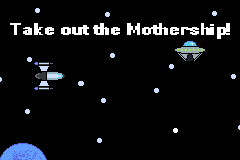

# orbital defense

Authors: Corey Brown. (forked from Auberon Lopez's repository: https://github.com/auberonedu/orbits).
Completed: 11/02/2026.

An exercise for learning about header files in C++. This program hands the player constrol of a starship that can spawn drones (orbiters), that realign their trajectory with the player's movements. The goal is to guide them with the ship (let's say their targeting is faulty for lore reasons), into the mothership to save the planet below. If they can destroy the motherhsip, the planet will be saved.

<!-- Link -->
Play it here! [https://cmbcoding.github.io/orbits/]
